# Poly Haven: Asphalt & Bitumen textures

**22 assets from [Poly Haven](https://polyhaven.com), dedicated to the public domain under [CC0](https://polyhaven.com/license).** Use them in any game, free or paid, and change them however you like; no credit is needed.

PBR textures as 1K and 2K JPG maps (colour, normal (GL and DX), roughness, AO, displacement and more). 605.5 MB in all.

This is a copy kept by [zuujis-cc0](https://github.com/zuujis-cc0) so game makers can take single files from GitHub. It is not made by or affiliated with Poly Haven: the originals, often in more formats and higher resolutions, are on [polyhaven.com](https://polyhaven.com). If they help you, consider [supporting Poly Haven](https://www.patreon.com/polyhaven/overview).

Every file is listed in [MANIFEST.tsv](MANIFEST.tsv) with its size and SHA-256. More free assets: [the Zuujis collection](https://github.com/zuujis-cc0/free-game-assets#readme).

| | | | |
| :-: | :-: | :-: | :-: |
| <a href="aerial_asphalt_01">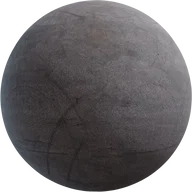</a> <b><a href="aerial_asphalt_01">Aerial Asphalt 01</a></b> by Rob Tuytel · <a href="https://polyhaven.com/a/aerial_asphalt_01">source</a> | <a href="asphalt_01">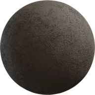</a> <b><a href="asphalt_01">Asphalt 01</a></b> by Charlotte Baglioni, Dario Barresi · <a href="https://polyhaven.com/a/asphalt_01">source</a> | <a href="asphalt_02">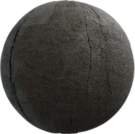</a> <b><a href="asphalt_02">Asphalt 02</a></b> by Rob Tuytel · <a href="https://polyhaven.com/a/asphalt_02">source</a> | <a href="asphalt_03">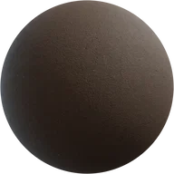</a> <b><a href="asphalt_03">Asphalt 03</a></b> by Charlotte Baglioni, Dario Barresi · <a href="https://polyhaven.com/a/asphalt_03">source</a> |
| <a href="asphalt_04">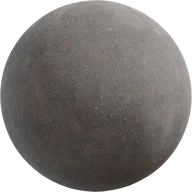</a> <b><a href="asphalt_04">Asphalt 04</a></b> by Jenelle van Heerden, Sergej Majboroda · <a href="https://polyhaven.com/a/asphalt_04">source</a> | <a href="asphalt_05">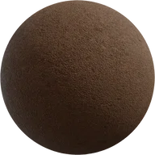</a> <b><a href="asphalt_05">Asphalt 05</a></b> by Amal Kumar · <a href="https://polyhaven.com/a/asphalt_05">source</a> | <a href="asphalt_06">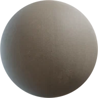</a> <b><a href="asphalt_06">Asphalt 06</a></b> by Jan Martens · <a href="https://polyhaven.com/a/asphalt_06">source</a> | <a href="asphalt_07">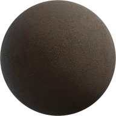</a> <b><a href="asphalt_07">Asphalt 07</a></b> by Charlotte Baglioni · <a href="https://polyhaven.com/a/asphalt_07">source</a> |
| <a href="asphalt_floor">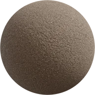</a> <b><a href="asphalt_floor">Asphalt Floor</a></b> by eye-candy.xyz · <a href="https://polyhaven.com/a/asphalt_floor">source</a> | <a href="asphalt_pit_lane">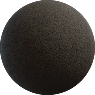</a> <b><a href="asphalt_pit_lane">Asphalt Pit Lane</a></b> by Dimitrios Savva · <a href="https://polyhaven.com/a/asphalt_pit_lane">source</a> | <a href="asphalt_snow">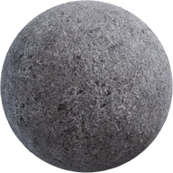</a> <b><a href="asphalt_snow">Asphalt Snow</a></b> by eye-candy.xyz · <a href="https://polyhaven.com/a/asphalt_snow">source</a> | <a href="asphalt_track">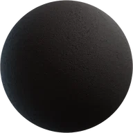</a> <b><a href="asphalt_track">Asphalt Track</a></b> by Dimitrios Savva · <a href="https://polyhaven.com/a/asphalt_track">source</a> |
| <a href="bitumen">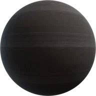</a> <b><a href="bitumen">Bitumen</a></b> by Rob Tuytel · <a href="https://polyhaven.com/a/bitumen">source</a> | <a href="clean_asphalt">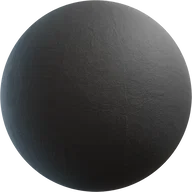</a> <b><a href="clean_asphalt">Clean Asphalt</a></b> by Dimitrios Savva · <a href="https://polyhaven.com/a/clean_asphalt">source</a> | <a href="cobblestone_embedded_asphalt">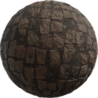</a> <b><a href="cobblestone_embedded_asphalt">Cobblestone Embedded Asphalt</a></b> by Amal Kumar · <a href="https://polyhaven.com/a/cobblestone_embedded_asphalt">source</a> | <a href="flower_scattered_asphalt">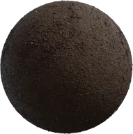</a> <b><a href="flower_scattered_asphalt">Flower Scattered Asphalt</a></b> by Dimitrios Savva · <a href="https://polyhaven.com/a/flower_scattered_asphalt">source</a> |
| <a href="gravel_road">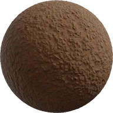</a> <b><a href="gravel_road">Gravel Road</a></b> by Amal Kumar · <a href="https://polyhaven.com/a/gravel_road">source</a> | <a href="road_damaged">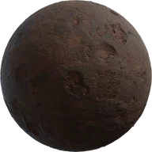</a> <b><a href="road_damaged">Road Damaged</a></b> by Dimitrios Savva · <a href="https://polyhaven.com/a/road_damaged">source</a> | <a href="road_damaged_2">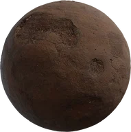</a> <b><a href="road_damaged_2">Road Damaged 2</a></b> by Dimitrios Savva · <a href="https://polyhaven.com/a/road_damaged_2">source</a> | <a href="road_damaged_clean">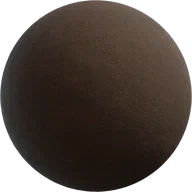</a> <b><a href="road_damaged_clean">Road Damaged Clean</a></b> by Dimitrios Savva · <a href="https://polyhaven.com/a/road_damaged_clean">source</a> |
| <a href="tarred_gravel">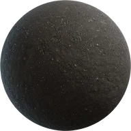</a> <b><a href="tarred_gravel">Tarred Gravel</a></b> by Dimitrios Savva · <a href="https://polyhaven.com/a/tarred_gravel">source</a> | <a href="worn_asphalt">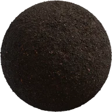</a> <b><a href="worn_asphalt">Worn Asphalt</a></b> by Amal Kumar · <a href="https://polyhaven.com/a/worn_asphalt">source</a> |  |  |

---

Kept up to date by this repository's own [update workflow](.github/workflows/update.yml), with code and plan from [cc0-mirror](https://github.com/zuujis-cc0/cc0-mirror). Something wrong? [Open an issue there](https://github.com/zuujis-cc0/cc0-mirror/issues/new) or use the [private report form](https://games.zuujis.com/report).
